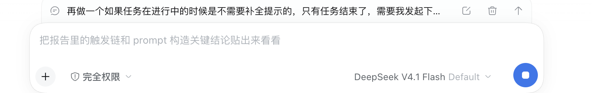
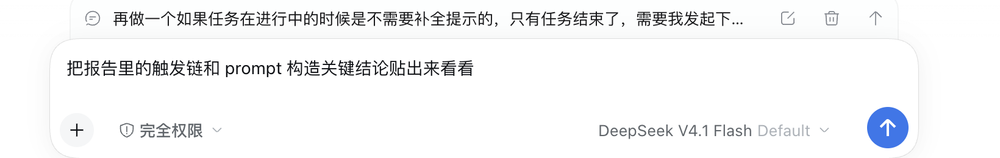

# 自动补全（`@local/dsh-autocomplete`）

把 Codex 桌面端「每轮任务结束后，输入框上方给一句下一句建议，按 Tab 自动填充」搬到 DSH 上。

建议是**输入框里的一行灰字**（不是上面多出来一排），就在你打字的位置，和 placeholder 同样字号、同样颜色；**输入框为空时**按 `Tab`（手机上点右侧「填入」）就把这句话变成真正的草稿，光标落在句末、**不会自动发送**，你可以改完再发。

## 效果图



*图：一轮任务结束后，输入框**内部**第一行出现灰字建议「把报告里的触发链和 prompt 构造关键结论贴出来看看」，桌面端没有按钮，只有这行灰字；placeholder 被这句话顶替，输入框仍是空的，直接打字就会忽略它。*



*图：按下 `Tab` 后，灰字变成真正的草稿，光标在句末，提示消失——可以随便改，也可以直接回车发送。*

## 怎么用

| 操作 | 结果 |
| --- | --- |
| `Tab`（输入框聚焦且为空） | 把建议填进输入框 |
| 切换到另一个对话 | 旧建议立刻消失，随后换成那个对话自己的建议（Host 现场补算） |
| 手机 / 触摸屏（没有 Tab） | 点右侧「填入」胶囊，效果和 Tab 一样（**只有触摸设备才出现**） |
| 直接打字 / 发送 | 建议消失，按你打的来 |
| 新一轮任务开始 | 旧建议立即清掉，等这一轮结束再出新建议 |

建议**只在输入框为空时**出现和生效，所以不会打断你正在写的草稿。手机上不习惯用 Tab 的话，直接点右边的「填入」即可。

## 手机 / 远程访问：没有 Tab 怎么办

你把远程插件把手机接上同一个 Host 时，页面就是同一个页面，只是没有物理键盘。这个插件不用你按 Tab：


*图：iPhone 宽度下，灰字建议同样在输入框里；因为没有 Tab 键，右侧胶囊从「Tab 补全」换成单个「填入」，触摸目标 52×32。*

- 桌面端**不显示按钮**，只有灰字 + `Tab`；触摸设备（`pointer: coarse`）才出现 **「填入」** 胶囊，高度 32px、最小宽度 52px。
- 胶囊和灰字是**两个相邻的绝对定位层**，不是父子嵌套：Safari 不会把点击派发给被 `pointer-events: none` 包裹的 `auto` 子元素——第一版正是踩了这个坑（按钮看得见、点不动）。现在点在按钮上还能在 `pointerdown` 就响应，不等 300ms 的 click 合成。
- 触摸时灰字宽度自动让出 68px，长句在胶囊前省略，不会互相覆盖。
- 灰字本身保持"点它就等于点进输入框"，不会误触；只有右侧胶囊是按钮。
- 软键盘弹出会平移 `visualViewport`（不是窗口 resize），插件同时监听 `visualViewport` 的 resize/scroll，灰字不会跟着跑偏。
- 灰字单行显示、超长省略号截断，手机上不会撑高输入框。

## 什么时候**不**出现

这是刻意设计的：只在"这一轮结束了、你要决定下一步"的那一刻给建议。

| 情况 | 行为 |
| --- | --- |
| 任务正在跑（`turn/start` 之后到 `turn/end` 之前） | **不显示**，并取消还没跑完的预测、撤销防抖定时器 |
| 输入框里有草稿 | 不显示，Tab 也不拦截 |
| 刚把那句话发出去（草稿刚变空） | 2 秒内不显示，避免旧建议闪一下 |
| 切到另一个对话、它还在跑 | 不显示（Host 用事件尾部判定，插件重载也不会误判） |
| 模型觉得没什么可说的 | 返回 `null`，不显示 |
| 这个会话还没有内容 | 不显示 |

前端会**一直轮询**状态（有建议时 700ms 一次、运行中 800ms、空闲 2.4s），不会因为"已经拿到建议"就停下——否则下一轮开始时没人通知它收回，灰字会一直挂着。

判定"在跑"有两条依据：内存里 `turn/start`/`turn/end` 的标记，以及**会话日志尾部扫描**（取最后 2000 个事件里最后一个 `turn/start` 还是 `turn/end`）。后者是为了覆盖"插件刚重载、或 Host 重启时正在跑"的情况——只靠内存标记会漏。

## 它是怎么来的

```
session/event …
  ├─ request/header   → 记住这个会话真正用的 provider/model
  ├─ user/message     → 最近 4 条人说的话（跳过 agent.inject 注入的上下文）
  ├─ assistant/message→ 最近 4 条回复
  ├─ tool/call        → 最近 24 个工具名
  └─ turn/end         → 700ms 后，向同一个 provider/model 发一次请求
  （打开历史对话时不等 turn/end：前端一问，Host 就用 ownEvents 现场折一份转录补算）
                          系统提示：你预测用户下一句会输入什么
                          schema：{ "suggestion": string | null }
                          （允许返回 null 表示"没什么好建议"，那就什么都不显示）
        ↓
   内存里按会话缓存 { status, text }
        ↓  GET /plugins/autocomplete/state?session=<id>
   前端 slot `conversation.input.dock` 渲染灰字 + Tab 键提示
        ↓ Tab
   props.inputActions.setDraft(text)   → 变成普通草稿
```

几个刻意的选择，和 Codex 那边的结论对齐：

- **用这个会话真正用的模型**（从 `request/header` 读），不是另配一个小模型；
- **只看真实对话**：`agent.inject()` 注入的上下文不算"用户会说的话"；
- **结构约束 + 允许弃权**：schema 里 `suggestion` 允许 `null`，模型不确定就不猜，避免噪音；
- **不写会话日志**：预测只是派生缓存，Host 重启后下一轮会重新算，丢了不影响任何东西；
- **新 turn 开始就清空**：绝不给过期建议。

## 和 Codex 原版的差异

| 维度 | Codex（cumberbatch） | 这个插件 |
| --- | --- | --- |
| 采样方式 | fork 当前线程成 ephemeral 副本，带完整工具上下文 | 折叠 `session/event` 得到精简转录（人/助手各 4 条 + 工具名） |
| 指令 prompt | 服务端 `/wham/predictions/config` 下发 | 插件内置（`index.js` 的 `INSTRUCTION`） |
| 呈现 | ProseMirror ghost 装饰，贴在光标后 | 输入框**里面**的一行灰字：`conversation.input.overlay` 槽 + 按编辑器首行坐标定位，临时隐藏 placeholder |
| 接受键 | Tab / → / Enter | Tab（点击也行） |
| 触发 | turn 结束 live + 打开线程 catch_up | 两者都做：turn/end 后自动算；切换/打开会话时按需补算 |

## 可调的旋钮

都在 `index.js` 顶部：`DELAY_MS`（默认 700ms）、`TIMEOUT_MS`（30s）、`MAX_TOKENS`（400）、`MAX_USER_TURNS` / `MAX_ASSISTANT_TURNS` / `MAX_TOOL_NAMES`、`MAX_EXCERPT`（每条消息截断长度），以及 `INSTRUCTION`（提示词，想换语气就改这里）。

## 自检接口

插件装好后，Host 上有三个只读/调试路由（都在本机、只监听 DSH 自己的端口）：

```bash
# 现在有哪些会话、最近一次预测状态、转录折叠情况
curl -s 'http://127.0.0.1:<DSH端口>/plugins/autocomplete/debug' | python3 -m json.tool

# 拿一段假转录跑一次真实模型，验证模型链路（不写任何状态）
curl -s -X POST 'http://127.0.0.1:<DSH端口>/plugins/autocomplete/predict' \
  -H 'content-type: application/json' \
  -d '{"transcript":"USER: 帮我把 README 补全\n\nASSISTANT: 已补全安装步骤。"}' | python3 -m json.tool

# 直接塞一条建议给某个会话，只看 UI（不调模型；截图/联调用）
curl -s -X POST 'http://127.0.0.1:<DSH端口>/plugins/autocomplete/seed' \
  -H 'content-type: application/json' \
  -d '{"session":"session-xxx","text":"把报告里的结论贴出来看看"}' | python3 -m json.tool
```

## 已知限制

- 灰字画在输入框**里面**，但不是真的写进编辑器：它是 `.overlay` 槽里的一个绝对定位元素，坐标按编辑器的首行内边距实时测量；所以光标、选择、撤销栈完全不受影响。
- 显示期间会临时隐藏 composer 自己的 placeholder（`[class*="placeholder"]`），隐藏时恢复；这是唯一一处动宿主 DOM 的地方。
- 判断"输入框是否为空"读的是那个 `contenteditable` 的文本（只读断言），不是 composer 的内部状态。
- 编辑器和输入框的类名是 CSS Modules 生成的（如 `JZLxKW_input`），插件只依赖 `contenteditable` 和 `[class*="placeholder"]` 这两个稳定特征。
- 打开历史会话的补算依赖 Host 的 `sessions.get()`；会话还没加载出来时会退回"下一轮再说"。
- 胶囊压在输入框第一行右端（那里本来就没字），只在触摸设备出现；桌面端没有这块遮挡。
- 万一手机上点了还是没反应，插件会把这次尝试上报到 `/plugins/autocomplete/tap`，`debug` 里能直接看到 `hasActions`（宿主有没有给 `setDraft`）和填充后的 `draftLength`，一眼定位是"没点到"还是"没写进去"。
- composer 的编辑器在 DOM 里排在这层覆盖之后、会挡住点击，所以灰字用 `z-index: 5` 提到卡片同一层叠上下文的上层；宿主若改了这一层的 isolation，需要重新校准。
