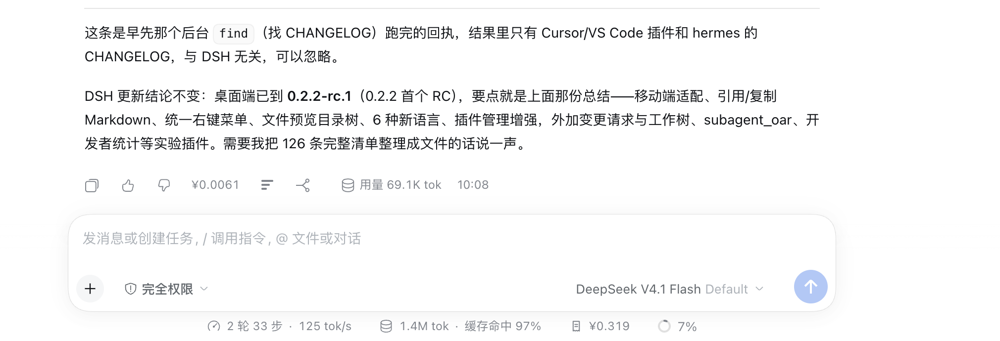

# 任务花费（@local/cost-stat）

在会话里直接看到「这条任务花了多少钱」：输入框下方的统计栏显示当前会话的模型调用花费估算，每条助手回复的底部操作行显示本轮花费，单位人民币（¥）。

## 效果图



*图：助手回复底部显示本轮花费 ¥0.0061，输入框下方统计栏显示当前会话累计 ¥0.319。*

## 两个显示位置

| 位置 | 内容 |
| --- | --- |
| 输入框下方统计栏（token 统计之后） | 当前会话累计花费；鼠标悬停展开分项明细 |
| 每条助手回复的底部操作行 | 本轮（Turn）花费，与复制、点赞等按钮同一行 |

悬停明细里可以看到：总花费、输入（未命中缓存）、输入（命中缓存）、缓存写入、输出各自的 token 数与花费，以及高峰 / 空闲两段的费用拆分。

## 计价方式

- 按**每条计费请求自身的用量与时间戳**累计，不按当前时间统一折算，所以一条会话跨越高峰 / 空闲分界时数字依然准确。
- 北京时间（UTC+8，无夏令时）工作日 **09:00–12:00、14:00–18:00** 为高峰；其余时段、周末与法定节假日为空闲时段（半价）。
- 单价（元 / 百万 token）：

| 项目 | 高峰 | 空闲（半价） |
| --- | --- | --- |
| 输入（未命中缓存） | ¥2 | ¥1 |
| 输入（命中缓存） | ¥0.04 | ¥0.02 |
| 缓存写入 | ¥2 | ¥1 |
| 输出 | ¥8 | ¥4 |

缓存写入按未命中输入的价格计费。

金额会按量级自动选精度：≥¥100 显示一位小数，≥¥1 两位，≥¥0.01 三位，≥¥0.0001 四位，更小显示 `<¥0.0001`。

## 数据来源与降级

Host 侧的 `index.js` 注册 `costUsage` 会话投影：把会话日志里每条 `assistant/message` 的 usage 按该请求时间戳对应的单价折成人民币，同时维护按 Turn、按消息的累计值，供回复底部显示本轮花费。

当 `costUsage` 投影不可用时（例如 Host 侧插件未加载、或旧会话还没生成该投影），客户端退回读宿主自带的 `tokenUsage` 总量，用**当前生效时段**的单价折算整条会话，并在数字前加 `≈` 标明这是近似值。

## 安装

在「插件 → 发现」里添加索引源 `https://15926719006.github.io/dsh-plugins-market/index.json`，搜索「任务花费」点安装即可；也可以直接用 Git 源安装：

```sh
dsh plugin --profile desktop add "git+https://github.com/15926719006/dsh-plugins-market.git#main&path:/plugins/dsh-cost-stat"
```

安装后刷新页面。本地开发时可以用 `dsh plugin --profile desktop add /path/to/dsh-cost-stat` 以 link 方式安装，改代码后刷新页面即可生效。

## 配置

没有配置项：不读取凭据、不发网络请求，全部在本地按会话日志计算。

价目表与 2026 年法定节假日表内置在 `index.js` 里。跨年后若未补节假日，该天会按工作日计价（费用偏高约一倍），在 `HOLIDAYS` 里补上即可。

## 实现

- `index.js`（Host）：`inject: ['sessionProjections']`，注册 `costUsage` 投影（stateVersion 2），`wire.view` 输出纯 JSON 快照；插件卸载时投影随之撤销。
- `client.js`（浏览器）：用 `useProjection('costUsage')` / `useProjection('tokenUsage')` 读数据；向 `conversation.composer.dock`（id `cost`，order 2）和 `conversation.chat.assistant-actions`（id `turn-cost`）两个槽位注册组件；界面文案以中英文字典内置在文件里。
- `locale/zh.json`、`locale/en.json`：插件列表里的标题与描述。
- 无额外运行时依赖，React 等直接取宿主提供的模块。

## 目录

```
dsh-cost-stat/
├── package.json        # dsh.bundle patch + dsh.client（web）
├── cordis.patch.yml    # 插入 cost-stat 一行 Host 插件
├── index.js            # Host：costUsage 会话投影（逐请求按时段计价）
├── client.js           # Client：输入框统计栏 + 回复底部花费
├── locale/zh.json      # 插件列表标题/描述
├── locale/en.json
├── icon.svg            # 收据图标
└── docs/preview.png    # 效果图
```
