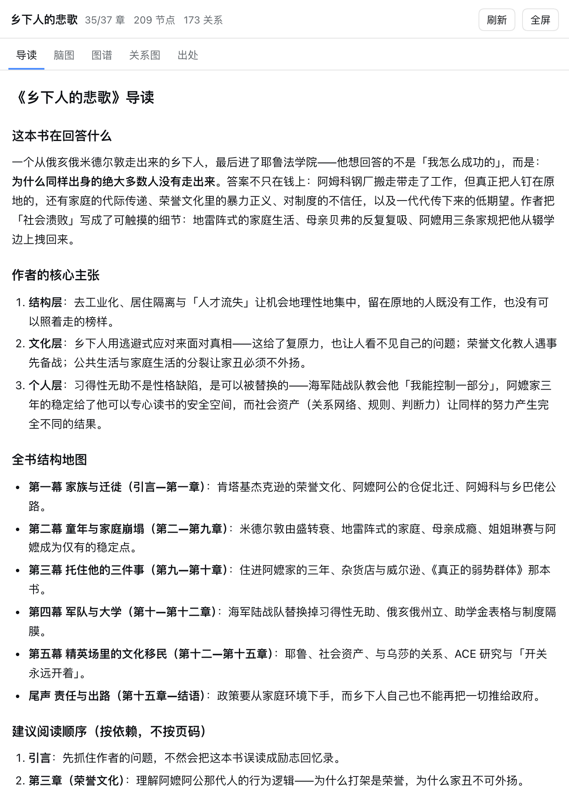

# 速读

把一本书拆成**导读、脑图、关系图、知识图谱**。每个节点、每条关系都必须点得回书里的原句；对不上原文的内容会被拒收——所以它是「读懂」，不是「生成一段很像总结的话」。

## 效果图


*图：《乡下人的悲歌》抽出的 209 个节点、173 条关系。点中「阿嬷」，下方抽屉给出她的说明、两处原句（各自可跳回原文）以及她与其它概念的关系；其余节点淡出，只留邻域。*



*图：同一本书的导读——这本书在回答什么、作者的三层主张、五幕结构地图、按依赖排的阅读顺序、每章一句话。*

## 怎么用

在会话里说一句：

```text
读一下这本书 /Users/你/Downloads/书名.epub
```

Agent 会先用 `book_import` 解析这本书，再逐章抽取。右侧栏的「速读」页会实时显示进度：

| 视图 | 内容 |
| --- | --- |
| 导读 | 这本书在回答什么 / 作者的核心主张 / 结构地图 / 建议阅读顺序 / 每章一句话 / 读完后能做什么 |
| 脑图 | 章节 → 概念的层级树，可折叠 |
| 图谱 | 力导向图：节点大小是重要性，颜色是类型，点击看详情并聚焦邻域 |
| 关系图 | 选中概念前后的因果 / 支撑 / 对立 / 依赖关系 |
| 出处 | 按章节列出所有被引用的原句，点一条跳回原文对应行 |

## 为什么它值得信

模型很容易编出一段“看起来对”的知识。这个插件的做法是：

1. 章节正文由 Host 切好并原样存盘；
2. 模型提出的每个节点、每条关系都必须带一句**原书引文**；
3. Host 在写盘前逐条比对（忽略空白、全半角引号、破折号差异）；
4. 对不上就拒收，并把**最接近的原文**回传给模型改；
5. 同一概念在别的章节再次出现会自动合并、累加出处，不重复造节点。

所以图谱不会比书更聪明——它只会比书更整齐。

## 数据在哪

全部在会话工作区的 `.dsh-books/` 下，一书一目录：

```text
.dsh-books/
  index.json
  book-a1b2c3d4/
    meta.json            # 书名、来源、章节表、进度
    chapters/0001.txt    # 章节原文（出处校验的依据）
    graph.json           # 节点 + 关系 + 出处
    guide.md             # 导读
    mindmap.json         # 脑图
```

可以 git、可以手改、可以直接看。建议把这个目录加进 `.gitignore`。

## 隐私

书和产物只存在你的工作区，插件不额外上传、不接第三方存储、不提供正文导出。
抽取时章节正文会作为上下文发给当前会话使用的模型——与你在 DSH 里贴一段文档同理。

## 支持的格式

| 格式 | 做法 |
| --- | --- |
| EPUB | 按书自己的 spine 顺序切章 |
| PDF（文字版） | PDFKit 取文字层，优先用书签当章节表 |
| PDF（扫描版） | 渲染后走 macOS Vision OCR（中文 + 英文），标注「OCR 可能有错字」 |
| TXT / Markdown / HTML | 按标题与段落切章 |
| DOCX | 按 Heading 1/2 切章 |
| 粘贴文本 | 直接给 Agent 一段正文 |

MOBI / AZW3 暂不支持，请先转成 EPUB。

## 成本

`book_import` 返回的 `estimate` 会先告诉你这本书大概要几次模型调用。
默认一章一次抽取；一本 15 章的书大约 17 次调用。随时可以停，`book_state` 会从断点继续。

## 已知限制

- 扫描版 PDF 的 OCR 会有错字，引文可能因此被拒收；拒收时会把最接近的原文回给模型修正。
- 图谱节点较多时（>150 个）默认折叠重要性低的节点，只保留核心节点与它们的邻居，折叠数量在右下角标出；标签只画给最重要的十几个节点，悬停或选中会补上。
- 只支持 macOS 上的 PDF OCR（依赖 Xcode 命令行工具）。

## 许可

MIT
