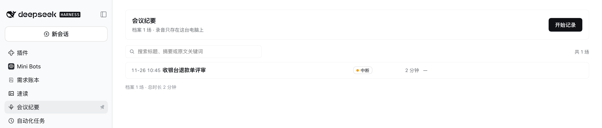
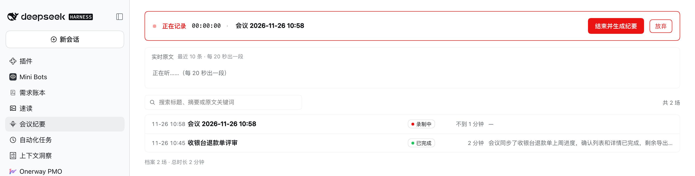
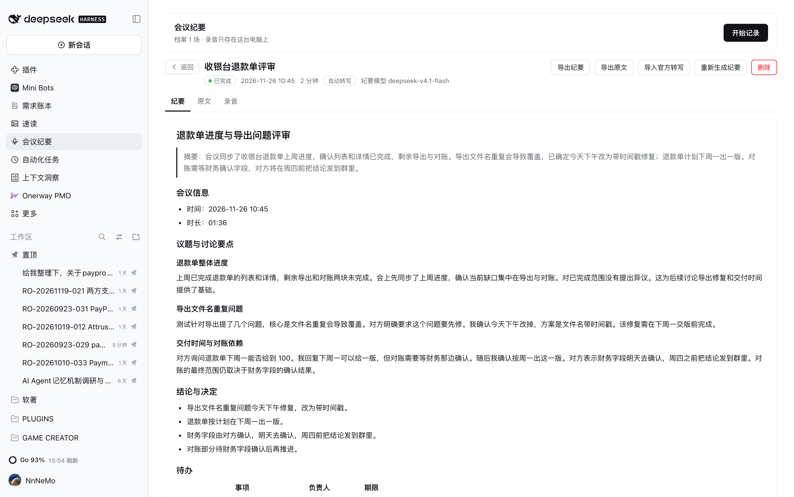
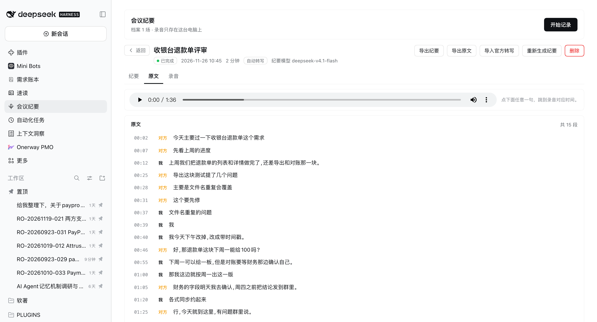

# 会议纪要（`@local/dsh-meeting-notes`）

开会时点一下「开始记录」：本机同时录下**对方的声音（系统声音）**和**你的麦克风**，边录边转写原文；点「结束并生成纪要」，自动出一份给自己看的纪要，每场会都留档在 `~/.dsh/meeting-notes/`。左侧栏有一个常驻入口（和「需求账本」「速读」同一排），点开是整页。

音频只存在这台电脑上，不会上传；生成纪要时只有**转写出来的文字**会发给 DSH 当前使用的模型。

## 效果图



*图：左侧栏的「会议纪要」入口和整页列表：每场会一行（日期、标题、状态徽标、时长、一句话摘要），顶部是「开始记录」。*



*图：录制中——顶部变红条，显示已录时长和会议标题，下面是实时原文（每 20 秒出一段，标好「我 / 对方」）。*



*图：点开一场会，纪要页：标题、摘要、会议信息、议题与讨论要点、结论与决定、待办表格（事项/负责人/期限）、风险与未决、关键原话。*



*图：原文页：上方是录音播放器，下面按时间轴列出每一句（我 / 对方），点任意一句跳到录音的对应时间。*

## 怎么用

| 位置 | 说明 |
| --- | --- |
| 左侧栏「会议纪要」 | 常驻入口，点开整页；跟随当前工作区，不唯一的会话也能用 |
| 「开始记录」 | 手动开始。**不自动监听会议**，需要时才点 |
| 录制中 | 显示已录时长；标题可以就地改；「结束并生成纪要」= 停止并转写、生成纪要；「放弃」= 删掉这场 |
| 历史列表 | 按日期倒序，带状态徽标（录制中 / 转写中 / 生成纪要 / 已完成 / 中断 / 失败）；搜索框按标题、摘要和原文关键词过滤 |
| 详情 · 纪要 | 模型按固定模板生成的纪要；可「重新生成纪要」 |
| 详情 · 原文 | 本机转写的时间轴；点一句跳录音；导入官方转写后可以切「自动版 / 官方版」 |
| 详情 · 录音 | 播放本场录音（m4a；如果转码失败会保留 wav） |
| 导出纪要 / 导出原文 | 下载 Markdown。对外的版本基于原文自己改 |
| 导入官方转写 | 把钉钉闪记 / 腾讯会议 / Teams 的转写整段粘进来，替换原文；本机自动版留底备查（不做时间对齐） |

数据都在本机：

```text
~/.dsh/meeting-notes/
  config.json                     设置（模型、语言、是否保留 wav…）
  bin/dsh-meeting-capture-<hash>  采集器（首次自动编译）
  models/ggml-large-v3-turbo.bin  语音模型（约 1.6GB，一次下载）
  records/20261126-104500/
    meta.json                     会议信息与状态
    audio.m4a                     录音（停止后从 wav 转成 AAC，省 6 倍空间）
    transcript.json / .md         原文（结构化 + 人读时间轴）
    transcript.auto.json / .md    导入官方转写后留下的本机自动版
    minutes.md                    纪要
```

## 第一次用要准备两样东西

1. **whisper.cpp**（本机转写引擎）：`brew install whisper.cpp`。设置好之后详情页会有「安装」按钮帮你跑这条命令。
2. **语音模型**：页面上点「下载」，把 `ggml-large-v3-turbo`（约 1.6GB）下到 `~/.dsh/meeting-notes/models/`。之后完全离线。

系统声音用 ScreenCaptureKit 抓，需要「屏幕与系统音频录制」权限；麦克风需要「麦克风」权限。**DSH 桌面版默认已具备**，第一次录音若系统弹权限提示，允许即可。

> 录音期间 DSH 必须开着——采集器是 DSH 的子进程；DSH 被强杀时采集器会自己收尾退出，音频文件不会坏。

## 它怎么工作

```text
开始记录
  └─ 采集器：系统声音 + 麦克风 → 一个 16kHz/16bit/2 声道 WAV（ch0=我, ch1=对方）
       └─ 每 20 秒切一块 → 左右声道分别本机 whisper 转写（先掐掉块首尾静音）
            └─ 合并成「[时间] 我/对方：…」实时原文，边录边存
结束
  └─ 补齐剩下的块 → 调 DSH 当前模型按模板出纪要 → 录音转 m4a → 归档
```

- **两条轨是同一个时钟**：ch0 是你的麦克风、ch1 是系统声音，所以「这句是谁说的」不需要猜，也不用声纹。
- 远端多人不会分人：对方那一路混在一起，只标「对方」。
- 状态机：`recording → transcribing → generating → ready`；出错是 `failed`，DSH 被强杀留下 `interrupted`，在列表里点「补完」可以续上（音频还在）。

## 设置（`~/.dsh/meeting-notes/config.json`）

| 字段 | 默认 | 说明 |
| --- | --- | --- |
| `language` | `zh` | whisper 语言；中英混说写 `zh` 就好 |
| `whisperModel` | `ggml-large-v3-turbo.bin` | 也可以填绝对路径，换成小模型（`ggml-medium`）更快 |
| `whisperBin` | 自动找 | 自定义 `whisper-cli` 路径 |
| `chunkSeconds` | `20` | 实时转写的切块长度（秒），越小越跟手、越费 CPU |
| `keepWav` | `false` | 归档后是否保留原始 wav |
| `vocabulary` | 空 | 给 whisper 的提示词，写公司术语、人名能提升识别率 |
| `minutesProvider` / `minutesModel` | 空 | 指定生成纪要用的模型；留空就用 DSH 当前默认模型 |

改完刷新页面即可，下一场生效。

## 接口

前缀 `/api/meeting-notes`，给前端用的：

| 方法 / 路径 | 作用 |
| --- | --- |
| `GET /state` | 当前状态：录制中、实时原文、准备情况（whisper/模型）、后台收尾进度 |
| `POST /start` `{title?}` | 开始记录 |
| `POST /stop` | 停止，后台转写 + 生成纪要 |
| `POST /cancel` | 放弃当前这场（删档案） |
| `GET /list` | 历史列表 |
| `GET /record?id=` | 详情（meta / 纪要 / 原文 / 自动版原文） |
| `GET /audio?id=` | 录音流（支持 Range，播放器可 seek） |
| `POST /rename` `{id,title}` | 改标题 |
| `POST /import` `{id,text}` | 导入官方转写 |
| `POST /regenerate` `{id}` | 重新生成纪要 |
| `POST /recover` `{id}` | 补完中断的档案 |
| `GET /export?id=&kind=minutes\|transcript` | 下载 Markdown |
| `DELETE /record?id=` | 删档案 |
| `POST /setup` `{action:'install-binary'\|'download-model'}` | 准备 whisper.cpp / 下载模型 |
| `GET/POST /config` | 读 / 存设置 |

## 排障

- **没有转写 / 一直在「正在听」**：看列表状态和 `~/.dsh/meeting-notes/dsh-meeting-notes.log`；确认系统声音有没有电平（录不到对方的声音，多半是权限或音频输出走了别的设备）。
- **安静会议里出现奇怪句子**：whisper 在噪声段会编固定句子，插件已过滤常见幻觉（「请不吝点赞…」「字幕由…」这类）；仍遇到可在 `config.json` 里把 `chunkSeconds` 调小。
- **时间戳偏移**：每块转写前会掐掉首尾静音再把偏移加回去，一般对得齐；句内时间戳是 whisper 估计值，误差一两秒正常。
- **音频在「开始记录」之前就在播**：可以抓到（采集器已关掉「排除当前进程音频」的开关，实测开录前就在播的声音能录到）。

## 开发与验证

```sh
node --test test/*.test.mjs        # 纯逻辑单测（WAV 切块、档案读写、JSON 解析、模板）
node test/capture.smoke.mjs        # 真机冒烟：编译采集器、录 6 秒、检查系统声轨电平
```

依赖：macOS（ScreenCaptureKit / AVFoundation）、`swiftc`（Xcode 命令行工具）、`whisper.cpp`、`ffmpeg`（转 m4a，缺失则保留 wav）。
