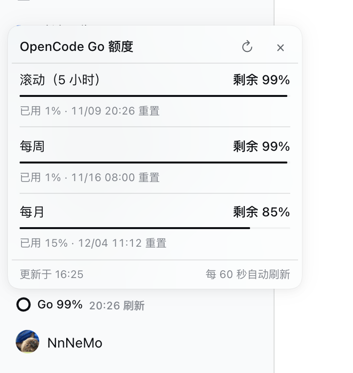
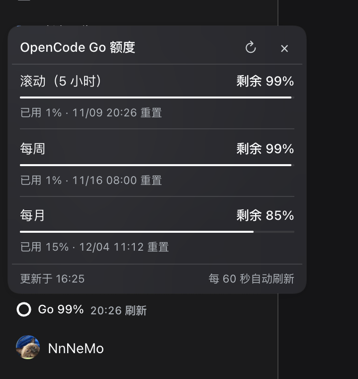

# OpenCode Go 额度（@local/dsh-opencode-quota）

把 OpenCode Go 订阅的**剩余额度**放到 Harness Web 页面的左下角：侧栏底部账号入口上方的一个小徽章，**默认预览滚动（5 小时）窗口**还剩多少、几点刷新；点开是一张与 DSH 原生菜单同材质的悬浮面板，列出滚动（5 小时）、每周、每月三个窗口的已用 / 剩余百分比与重置时间。

## 效果图



*图：左下角 `Go 99% · 20:26 刷新` 徽章——预览的是 5 小时滚动窗口，后面是它的刷新时间；点开后是与 DSH 原生菜单一致的磨砂悬浮面板，列出三个窗口的剩余 / 已用百分比、重置时间与进度条。*



*图：同一面板在深色主题下；磨砂底、分隔线、文字与状态色全部取自 DSH token，随主题自动切换。*

## 为什么是这个位置

`sidebar.footer.action` 槽位就是页面左下角、账号入口上方这一行。它不占用侧栏导航项，也不进输入框，高度（24px）、圆角（8px）与 hover 背景都跟原生 footer 按钮一致；侧栏收起成 56px 轨道时（`wide === false`）只留圆环，百分比和刷新时间进 title。

## 数据从哪来

```
浏览器（左下角徽章 / 面板）
   │  GET /plugins/opencode-quota/usage     ← 同源、只读、只返回百分比
   ▼
Host 插件（本包的 index.js）
   │  ctx.credentials.resolve("OPENCODE_GO_API_KEY")
   │  GET https://opencode.ai/zen/go/v1/usage
   │  Authorization: Bearer <api-key>
   ▼
opencode.ai 订阅用量接口
   { usage: { rolling, weekly, monthly } } → percent / resetsAt
```

- API key 只在 Host 进程内解析，**不会下发浏览器**。
- 成功率结果缓存 30 秒；失败不缓存，下次点击立即重试。
- 只展示百分比，不做金额换算：OpenCode Go 不同模型的额度金额不同，换算成美元会误导。
- 路由只接受 `GET` / `HEAD`（其它方法 405），冷缓存下并发请求合并为一次上游调用。

## 显示规则

| 位置 | 内容 |
| --- | --- |
| 徽章 | 预览**滚动（5 小时）**窗口：圆环进度 + `Go NN%` + `HH:mm 刷新`。5 小时窗口是恢复最快、真正决定"这一轮还能不能继续跑"的那一个；每周 / 每月在面板里看 |
| 刷新时间 | 当天只显示 `HH:mm`，跨天显示 `MM/DD HH:mm`；已到重置时刻显示「即将刷新」 |
| 圆环颜色 | ≥30% 用品牌色，10–29% 用 warn，<10% 用 error |
| 悬浮面板 | 三个窗口：剩余 %、已用 %、重置时间、进度条 |
| 风格 | 沿用 DSH 原生浮层配方：`--dsw-menu-surface-fill` 磨砂底 + `blur(40px) saturate(150%)`、16px 圆角、`elevation-prominent` 阴影、13px/20px 字号、0.5px 分隔线、hover 用 `--dsw-alias-interactive-bg-hover`；深色主题自动跟随 |
| 刷新 | 关闭面板时 5 分钟一次；打开后 60 秒一次；面板内 `↻` 手动刷新；刷新失败时保留上次数字并在面板脚注标注「显示上次结果」 |
| 交互 | 点击开合，`Esc` 或点击面板外关闭，面板锚定在徽章上方 4px 处并自动避让视口边缘 |

## 安装

在「插件 → 发现」里添加索引源 `https://15926719006.github.io/dsh-plugins-market/index.json`，搜索「OpenCode Go 额度」点安装即可；也可以直接用 Git 源安装：

```sh
dsh plugin --profile desktop add "git+https://github.com/15926719006/dsh-plugins-market.git#main&path:/plugins/dsh-opencode-quota"
```

安装后刷新页面，左下角账号入口上方出现 `Go NN% · HH:mm 刷新`。

## 配置

没有配置项。凭据引用固定为 `OPENCODE_GO_API_KEY`（`~/.dsh/.credentials.yaml` 里已有），上游地址固定为 `https://opencode.ai/zen/go/v1/usage`。

## 目录

```
dsh-opencode-quota/
├── package.json        # bundle patch + dsh.client（web）
├── cordis.patch.yml    # 插入 opencode-quota 一行 Host 插件
├── index.js            # Host：凭据解析 + /plugins/opencode-quota/usage 只读路由
├── client.js           # Client：sidebar.footer.action 徽章 + 悬浮面板
├── locale/zh.json      # 插件列表里的标题/描述
├── docs/preview.png    # README / 插件详情页的效果图（真实运行截图）
├── locale/en.json
└── icon.svg            # 原创图标：剩余额度仪表环
```

`icon.svg` 为本插件原创（仪表环 + 中心点），MIT，可随包分发。

## 已知边界

- `GET /plugins/opencode-quota/usage` 不做鉴权，继承 webServer 的绑定地址（默认 `127.0.0.1`，仅本机可访问）。接口只返回百分比，不含 key。
- 仅适用于带 Web 服务的 profile（desktop / `dsh web`）；host 行 `inject` 依赖 `webServer`，headless 下不激活。
