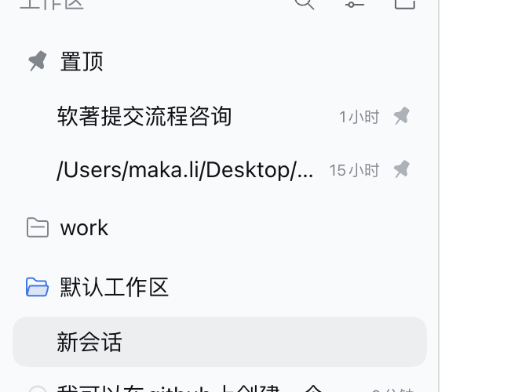
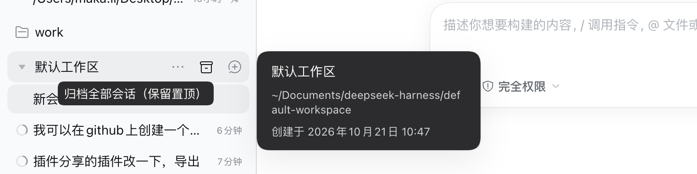

# 置顶在最上

`@local/dsh-pinned-top`：把置顶会话收拢到侧边栏最上方的「置顶」分区，并给每个工作区行加一个「归档全部会话（保留置顶）」按钮。

## 效果图



*图：侧边栏最上方的「置顶」分区，两条置顶会话排在所有工作区之上，不展开工作区也能看到。*



*图：鼠标移到工作区行时出现的归档按钮，提示为「归档全部会话（保留置顶）」。*

## 功能说明

置顶会话拥有独立的「置顶」分区，位于侧边栏最上方、所有工作区分组之前：内容就是 Host 的置顶集合，最近置顶的排在前面。

置顶行会离开它所属的工作区分组，因此不需要展开或滚动工作区就能看到；取消置顶后，该行回到工作区顺序规定的位置。运行状态本身不会移动行——只有置顶会。

工作区行悬停时还会出现「归档全部会话（保留置顶）」按钮：一次点击归档该工作区下所有普通会话，同时保留其中的置顶会话。

## 实现方式

这是官方 `@deepseek-ai/dsh-client-ui-workspace` 浏览器 bundle 的一个 fork，因此和官方插件一样完整接管 `sidebar.workspaces` 区域（相同的搜索、视图选项、拖拽、对话框、行菜单与行操作）。由于替换了该 bundle，它同时**提供 `uiWorkspace` 客户端服务**——会话输入框/编辑器、聊天行、侧边栏装饰、agent-preset 菜单和目录选择器都在 inject 这个服务。因此替换本插件的代码会牵动上述每一个使用方，参见「在应用运行时更新」。

补丁是对该 bundle 的一处小而确定的修改：

- `deriveGroups` 生成一个合成的前置分组（key 为 `__pinned__`），按置顶顺序容纳 Host 的置顶集合，并把这些行从各自的工作区分组中过滤掉；
- 该分区不应用每个分组的行水位线，所以所有置顶行始终可见；
- 分区标题显示置顶图标，不可拖拽，也不带工作区操作（重命名 / 删除 / 新建会话）；
- 置顶行不能通过拖拽调整顺序：顺序跟随 Host 的置顶顺序；
- 新增 locale key `group.pinned`，提供「置顶」文案；
- 每个工作区行在「...」菜单与「新建会话」按钮之间新增一个悬停出现的归档按钮，仅当该工作区存在可归档会话时渲染。它通过共享的归档操作归档该工作区里所有普通、未归档、**未置顶**的会话；已归档行、新建会话草稿、子代理子会话和置顶行都不动；正在运行的会话会被计数并作为「跳过」上报，而不是被停止。结果显示在侧边栏的 Workspace 通知里。

### 为什么批量归档排除置顶会话

在 Host 上，置顶与归档互斥：`archiveSession` 会在同一次持久化写入里把该会话从置顶集合中移除，而归档的会话无法重新置顶。此外，置顶行已不再渲染在它所属的工作区分组里（本 fork 把它提到顶部分区），如果对那个分组批量归档，会归档并取消置顶一条用户在该分组里根本看不到的行。因此批量归档的目标规则会过滤置顶集合；行上的悬停按钮也用同一规则统计目标，所以一个只剩置顶会话的工作区不会显示按钮。要归档某条置顶行，仍可从它自己的菜单逐条操作——那是对该行的明确选择。点击执行期间被置顶的会话，会在每次调用 Host 前重新检查并被跳过。

其余部分与上游 bundle 完全一致。

## 测试

```sh
node test/groups.test.mjs
```

覆盖编译后 fork 的合成分区：置顶顺序、折叠的工作区与折叠的分区、归档过滤、缺失的 id、行回到各自分组，以及运行状态本身绝不会把行提上来。也固定了一键归档的成员规则：已归档行、空白草稿、子代理子会话、置顶行和没有加载摘要的成员都排除；悬停按钮的计数由同一规则推导，所以只有置顶行的工作区不显示按钮。

## 安装

作为 profile bundle 安装；它的 patch 会禁用官方 `ui-workspace` 行并插入本 fork，因此两者不会重复注册同一批 slot。

## DSH 升级后重建

fork 内嵌了一份官方 Client bundle 的副本，它随应用变化。更新桌面应用后，针对新安装重新生成：

```sh
node build/fork.mjs
```

脚本直接读取 `app.asar`，上游锚点（anchor）移动时会明确报错，而不是发布一个只打了一半补丁的侧边栏。如果报某个锚点缺失，请对比新版 `lib/client.js` 中对应的位置并更新 `build/fork.mjs`。

## 在应用运行时更新

本插件不是边缘装饰：它替换官方的 workspace 浏览器，并且是 `uiWorkspace` 客户端服务的提供方；会话输入框/编辑器（`ui-conversation`）、聊天行（`ui-chat`）、侧边栏、定时任务、agent-preset 和目录选择器插件都在 `inject` 中声明了它。因此替换它的代码会拆掉这些使用方再重新创建。这正是「改一下侧栏，对话框/输入框就没了」背后的机制。

`lib/client.js` 由运行中的 Harness 提供，客户端 HMR watcher 大约每 500 ms 轮询每个已启用 graph 行的产物文件。在该行**启用**时重写它会发布一个 `rebuilt` 帧，页面把它当作**原地代码替换**应用：旧的 fiber 被排空，新 bundle 挂载。当前 DSH 版本会通过 Cordis 的激活 epoch 重新级联依赖（`dsh-client-hmr`，「Cascade and self-reload」），所以注入它的视图会带着新插件回来。导入或激活失败**没有回滚**，因此坏构建会把页面弄坏。

### 发布流程

1. **页面关闭（确定性，首选）。** 在没有打开页面时重建，然后再打开或刷新页面。不会发布替换，也就不会拆掉使用方。页面关闭期间会话仍在 Host 上运行。
2. **页面打开、行启用（普通 HMR 重建）。** 写入产物并让 watcher 替换。依赖重新级联，输入框重新挂载；被重载插件里的 React 状态会丢失（会话、工作区和草稿数据不会）。请先验证构建和 `test/groups.test.mjs`，因为坏替换不会回滚。

绝不要用「禁用行 → 重建 → 再启用」的方式发布。watcher 不跟踪已禁用行，因此不会发布 `rebuilt` 帧——但重新启用属于普通 graph 变更，而 DSH 明确说明：替换包代码并连同其现有使用方一起替换，属于普通启用/禁用同步*之外*的行为（`dsh-client-modules`，「Known limitations」）。2026-11-04 那次操作让输入框一直未挂载，直到页面重启才恢复。把改动作为新 bundle 版本发布属于同一类 graph 变更：适合安装，但不是迭代本 fork 的更好方式。

### 找回丢失输入框的页面

1. **刷新页面（Cmd+R）。** 全新的启动会重建整个客户端插件树，包括每个 `uiWorkspace` 使用方。不需要重启应用，也不会丢失会话。
2. 如果刷新后的页面仍然没有输入框，**先不要**重启应用：打开 设置 → 插件 → 插件列表（它会显示页面级的同步失败，并在不改变 Host 启用状态的情况下重试），记录它报告的内容——重启会销毁证据。
3. 只有当上面两步都失败时才重启应用。

`node build/fork.mjs` 以原子方式写入（临时文件 + rename），所以轮询永远不会发布写了一半的 bundle；并且每次构建后都会重述上面的规则。

## 卸载 / 还原

移除该 bundle（插件页，或 `plugin_manager` 的 `remove_bundle`）；patch 层随之消失，官方 `ui-workspace` 行重新激活，侧边栏回到官方分组。
