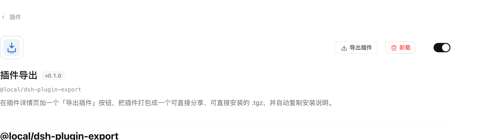

# 插件导出

`@local/dsh-plugin-export`：为每个已安装 bundle 的插件详情页加上「导出插件」按钮，一键把插件打包成可直接分享、可直接安装的 `.tgz`。

## 效果图



*图：插件详情页右上角的「导出插件」按钮，与「卸载」和启用开关并排。*

## 功能

在已安装 bundle 的插件详情页（侧边栏 → 插件 → 某个 bundle）点一次「导出插件」，会：

1. 下载一个可分享的 `@local/my-plugin-1.0.0.tgz`（标准 npm tarball）；
2. 把安装说明复制到剪贴板，分享时不必再单独解释这个文件是什么、怎么安装。

## 接收方怎么安装

打开 DSH → **插件** → **添加插件**，粘贴 `.tgz` 文件的绝对路径（例如 `~/Downloads/my-plugin-1.0.0.tgz`）。Plugin Manager 会把绝对 `.tgz` 路径识别为 tarball spec，用 pnpm 安装并启用。先解压、再粘贴 `package/` 目录路径也可以。

## 归档内容

npm pack 风格的 tarball：包内所有文件位于 `package/` 下，另外生成一份中文的 `package/EXPORT-NOTE.md`，写明包名、描述和安装步骤。排除 `node_modules`、`.git` 和操作系统产生的杂项文件；依赖在安装时按包自身 `package.json` 解析。限制：每个 bundle 64 MiB / 4000 个条目。

## 实现

- **Host**（`index.js`、`tar.js`）：通过 `ctx.connection.fetch` 注册认证路由 `GET|HEAD /api/plugin.export?name=<package>`。包目录通过 Loader 自身的解析基（与客户端模块注册表相同的规则）解析，因此 linked、npm、git 和内置行都能解析。归档只用 Node 内置模块构建，不给 profile 增加依赖。
- **Client**（`client.js`）：向 `plugins.detail.actions` 槽注册一个按钮，用详情页的 subject 渲染；仅对已安装的 `kind: 'bundle'` 渲染。它先发一个 `HEAD`，让失败（包不存在、超出限制）以文字显示而不是静默下载；然后把 `GET` 路由交给浏览器下载管理器，并复制安装说明。

## 测试

```sh
node test/tar.test.mjs     # 归档结构、排除项、限制
node test/route.test.mjs   # 包解析 + 路由处理，真实 .tgz 往返
```
