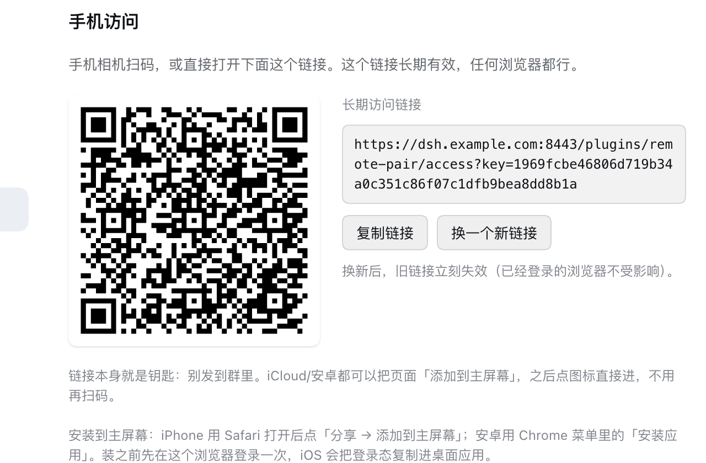
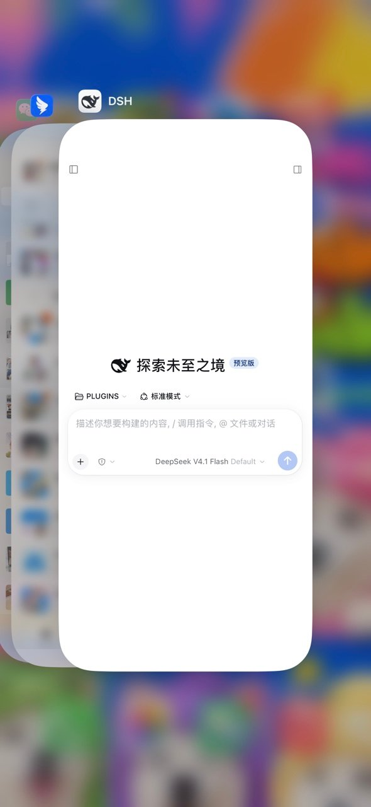

## 效果图



*图：设置 → 手机访问。左边是二维码，右边是长期访问链接，可一键复制或换新链接。*



*图：手机「添加到主屏幕」后点开的样子——直接进入已登录的 DSH，不再出现在浏览器地址栏里。*

## 它解决什么

DSH 的 Web 界面只监听本机 loopback，手机打不开。就算用隧道把它暴露到公网，手机第一次访问仍然需要一条带登录令牌的链接——那条链接本身就是凭据，发一次聊天就泄漏一次。

这个插件把「手机怎么拿到登录态」这件事收进设置页：

- 生成一条**长期访问链接**（带 key，存在 `$DSH_HOME/remote-pair/access.json`，权限 600）和对应二维码；
- 任何浏览器打开这条链接 → 插件校验 key → 302 到 DSH 自己的 `authenticatedUrl()` → **由 DSH 签发会话 cookie**；
- 插件不接触签名密钥、不生成 cookie，所以 DSH 升级不会让它失效；
- 想作废就点「换一个新链接」，旧链接立刻失效（已登录的浏览器不受影响）。

页面本身可作为 Web App 安装（DSH 自带 manifest 与 192/512 图标，插件补上 iOS 需要的 head 标签）；登录之后再「添加到主屏幕」，iOS 17.2+ 会把登录态复制进桌面应用，之后点图标直接进。

## 前置条件：你需要一台服务器

插件只负责「配对」这一层，**手机和电脑之间的那条路要你自己提供**。因为 DSH 只监听 `127.0.0.1`，手机在移动网络下必须经由一台有公网入口的机器转接。

最小要求：

| 项 | 要求 |
| --- | --- |
| 机器 | 任意 Linux，1 核 1G 足够（隧道进程常驻内存约 30 MB） |
| 网络 | 一个公网 IP；一个域名（或接受自签证书） |
| 端口 | 一个对外端口（例如 8443）+ 一个隧道控制端口（例如 443） |

三种接法，选一种：

| 方式 | 适合 | 代价 |
| --- | --- | --- |
| **自建 frp**（下面给完整步骤） | 有自己的服务器，想完全掌控 | 要配证书与反向代理，约 15 分钟 |
| **Tailscale** | 不想碰证书和端口 | 手机和电脑都要装 Tailscale |
| **Cloudflare Tunnel** | 不想买服务器 | 流量过 Cloudflare；快速隧道每次重启换域名 |

> 大陆机房的备案提醒：域名走 80/443 提供网站服务需要 ICP 备案，未备案会被拦。常见做法是走非标端口（如 8443），TLS 用 DNS-01 校验签发，不需要开 80 端口。

## 部署手册（自建 frp）

下面把服务器写成 `YOUR_SERVER_IP`，域名写成 `dsh.example.com`，按自己的替换。

**1. 域名解析**

```
dsh.example.com  A  YOUR_SERVER_IP
```

**2. 签证书（DNS-01，不需要 80 端口）**

```sh
curl https://get.acme.sh | sh -s email=you@example.com
export Ali_Key=<DNS 权限的 AccessKey> Ali_Secret=<对应 Secret>
~/.acme.sh/acme.sh --set-default-ca --server letsencrypt
~/.acme.sh/acme.sh --issue --dns dns_ali -d dsh.example.com --keylength ec-256
~/.acme.sh/acme.sh --install-cert -d dsh.example.com --ecc \
  --key-file /etc/nginx/ssl/dsh.key --fullchain-file /etc/nginx/ssl/dsh.pem \
  --reloadcmd "systemctl reload nginx"
```

**3. 隧道服务端 frps**

```toml
# /etc/frp/frps.toml
bindAddr = "0.0.0.0"
bindPort = 443              # 隧道控制端口
proxyBindAddr = "127.0.0.1" # 回源端口只对本机 nginx 开放
vhostHTTPPort = 8080
auth.method = "token"
auth.token = "<随机长串>"
transport.tls.force = true
```

**4. nginx 终止 TLS**

```nginx
server {
    listen 8443 ssl;
    server_name dsh.example.com;
    ssl_certificate     /etc/nginx/ssl/dsh.pem;
    ssl_certificate_key /etc/nginx/ssl/dsh.key;
    client_max_body_size 320m;

    location / {
        proxy_pass http://127.0.0.1:8080;
        proxy_http_version 1.1;
        proxy_set_header Host $http_host;   # 必须保留端口，DSH 的 Origin 校验要求同 authority
        proxy_set_header Upgrade $http_upgrade;
        proxy_set_header Connection "upgrade";
        proxy_buffering off;
        proxy_read_timeout 3600s;
        proxy_send_timeout 3600s;
    }
}
```

**5. 本机 frpc**

```toml
# ~/.config/frp/frpc.toml
serverAddr = "YOUR_SERVER_IP"
serverPort = 443
transport.tls.enable = true
auth.method = "token"
auth.token = "<与 frps 相同>"

[[proxies]]
name = "dsh-web"
type = "http"
localIP = "127.0.0.1"
localPort = 38471            # 与下一步固定的端口一致
customDomains = ["dsh.example.com"]
```

**6. DSH 侧三行配置**（`$DSH_HOME/profiles/<profile>/cordis.patch.yml`）

```yaml
- id: webserver
  name: "@deepseek-ai/dsh-host-webserver"
  config: {host: 127.0.0.1, port: 38471, tls: null, compression: gzip,
           compressionLevel: 1, compressionThresholdBytes: 1024}
- id: connection
  name: "@deepseek-ai/dsh-client-connection"
  config: {trustedHosts: ["dsh.example.com"], cookieMaxAgeDays: 3650}
```

`port` 固定是因为 Desktop 默认 `--port 0` 随机分配，frpc 没法跟随；`trustedHosts` 让公网 authority 通过 Host/Origin 栅栏；`cookieMaxAgeDays` 默认只有 30 天。

**7. 装插件并填地址**：设置 → 手机访问，把 `publicBaseUrl` 配成 `https://dsh.example.com:8443`。

**8. 验证**：手机打开面板上的链接，能进会话列表就成了。

## 配置

| 字段 | 默认 | 说明 |
| --- | --- | --- |
| `publicBaseUrl` | 空（可用 `DSH_REMOTE_PUBLIC_URL`） | 手机访问的公网入口，不带结尾斜杠；留空则配对关闭 |
| `codeTtlSeconds` | `60` | 一次性配对码有效期 |
| `maxAttempts` | `5` | 同一个码允许失败几次，超过即作废 |

## 安全设计

- **长期 key 只在服务端比对**，校验通过才 302 到 DSH 的一次性登录地址；插件不生成 cookie、不碰签名密钥；
- **一次性配对码**（`/pair?code=…`，6 位、60 秒、错 5 次作废、每 IP 每分钟 10 次）用于临时带新设备进来；
- **桌面接口只认本机**：`/state`、`/rotate`、`/qr.svg` 检查 `Host` 必须是 loopback，公网请求一律 403；
- **长期链接等同密码**：别外发，泄露就点「换一个新链接」。

## 已知限制

- 手机能连上的前提是**电脑醒着且 DSH 在跑**：服务器只做中继，不存会话、不跑 DSH；
- 没有按设备撤销：`/rotate` 是整条链接级别，已登录的浏览器要等 cookie 失效（10 年）或清站点数据；
- 服务器上 TLS 终结意味着**它能看到明文**，选择服务器时要按这个前提判断；
- 公网入口（域名、证书、端口放行、备案）需要你自己搭，插件不代管。
