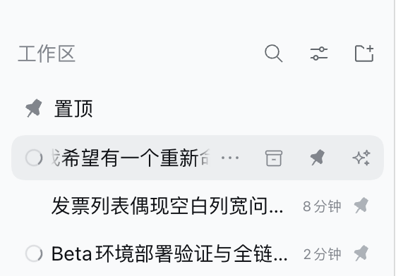
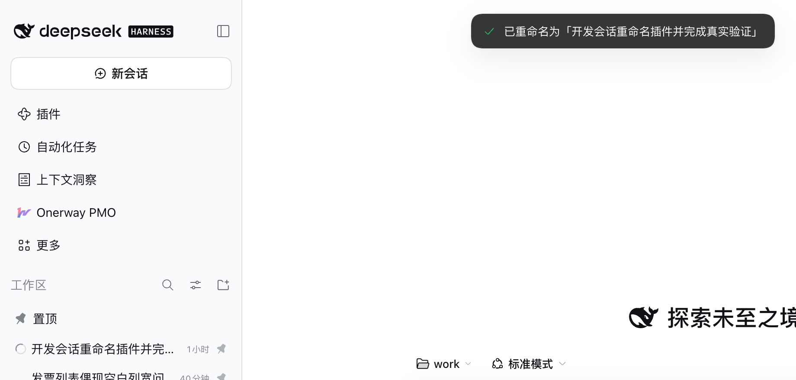
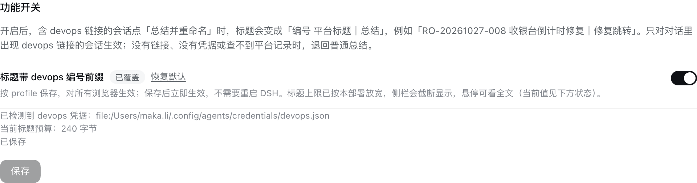
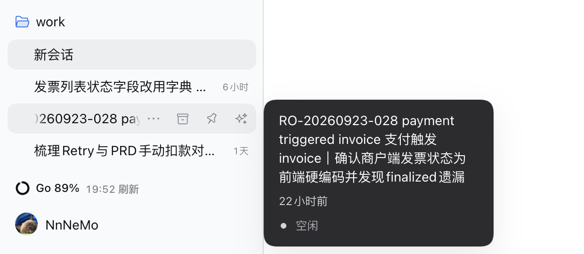

# 总结重命名（`@local/session-rename`）

会话标题常常停在第一轮对话的缩写上，看不懂这个会话后来到底在做什么。这个插件在侧栏每个会话行悬停时加一个按钮：**点一下，读完整段对话，概括成一行标题，直接把这个会话改名**——不用手动打字。

## 效果图



*图：鼠标移到会话行上，右侧按钮区出现「更多 / 归档 / 置顶 / 总结重命名」；悬停 sparkle 图标提示「总结并重命名」。按钮排在置顶按钮右边，不需要安装置顶或归档插件也能用。*



*图：点击后约 2 秒，会话标题被概括成「开发会话重命名插件并完成真实验证」，顶部居中提示「已重命名为「…」」。*



*图：插件页（插件 → 已安装插件 → 总结重命名）详情文档下方的「功能开关」区：开关、格式说明、凭据检测结果、当前标题预算与保存按钮。*



*图：开启开关后，含 devops 链接的会话标题变成「编号 平台标题｜总结」，例如 `RO-20260923-028 payment triggered invoice 支付触发 invoice｜确认商户端发票状态为前端硬编码并发现finalized遗漏`；侧栏截断显示，悬停卡片可看全文。*

## 怎么用

| 项目 | 说明 |
| --- | --- |
| 位置 | 会话行悬停（或键盘聚焦）时出现的行内按钮区，紧挨着置顶按钮右侧 |
| 触发 | 点一下 sparkle 按钮；生成期间图标旋转、按钮禁用，避免重复点击 |
| 读什么 | 该会话的完整对话：所有人发消息 + 助手回复里的文字（工具调用、图片、附件不喂给模型）；超长时首条消息最多占输入预算的 40%，优先保留最近上下文 |
| 怎么概括 | 用**这个会话自己的模型路由**（最后一条请求记录的 provider/model），以模型支持的最低推理强度单独调一次模型 |
| 标题规则 | 一句话概括最终任务/产出；跟随对话语言；中文约 20 字、非中文约 8 词；去掉引号、编号、Markdown、控制字符，只留一行。开关开启且命中 devops 记录时改为「编号 平台标题｜短总结」 |
| 写入 | 走官方会话服务的 `rename`：持久化为用户标题并**钉住**，之后自动标题不会再覆盖它 |
| 成功反馈 | 标题立即刷新，按钮短暂变成对勾，顶部居中提示「已重命名为「…」」 |
| 失败反馈 | 原标题不动，提示「总结失败：<原因>」（还没有用户消息 / 没有模型路由 / 超时 / 模型输出不可用等） |
| 冷会话 | 旧会话没在内存里也能用：先按需读取日志，改名时由官方会话服务恢复该会话 |

## DevOps 编号前缀（插件页开关）

默认关闭。在 **插件 → 已安装插件 → 总结重命名** 的详情页下方打开「标题带 devops 编号前缀」，保存后立即生效（写入当前 profile 的 `cordis.patch.yml`，跨浏览器一致，不需要重启）。

开启后，只有当这个会话的对话里出现 devops 链接时才会加前缀：

| 项目 | 说明 |
| --- | --- |
| 格式 | `编号 平台标题｜总结`，例如 `RO-20261027-008 收银台支付结果倒计时不跳转修复｜修复倒计时跳转` |
| 识别范围 | 需求 `#demand/RO-…`、任务 `/task/<T号或数字id>`、发布单、专项、issue、子任务、缺陷 `#defect/BUG-…`，以及正文里的纯编号（任务 `T-…`、需求 `RO-…`、缺陷 `BUG-…` 等）。缺陷只认 `BUG-…` 编号，数字 id 的缺陷链接无法解析（不上报状态） |
| 取标题 | 只读调用 DevOps 平台 API，取该记录的「编号 + 平台标题」；每次请求 5 秒超时，失败静默退回普通总结 |
| 总结 | 有前缀时模型只写一句短总结（目标约 12 个汉字），不重复编号和平台标题 |
| 标题长度 | 本部署把标题上限从 80 字节放宽到 240 字节（只放宽上限，自动标题仍是短标题）；侧栏截断显示、悬停看全文；预算不足时自动压缩成 `编号｜总结` |
| 凭据 | 自动读取，优先级：`DEVOPS_TOKEN`/`DEVOPS_API_KEY` → `$DEVOPS_CREDENTIALS_FILE` → `~/.config/agents/credentials/devops.json` → `~/.config/agents/credentials/onerway-devops.env`；插件页会显示检测到的来源，不显示 token |
| 无链接 / 查不到 | 退回普通的纯总结标题，重命名照常成功 |

## 为什么不是「自动更新标题」

DSH 自带的实验标题包会在新消息到来时更新标题，但它被要求「已有标题仍能描述主题时逐字保留」，所以常常停在第一轮。这个插件只在你点击时工作：想改哪个会话就改哪个，不替你做主。

## 实现方式

- **Host 半**（`index.js`）：
  - 注册 `POST /api/session-rename`（`ctx.connection.fetch.register`），body `{ sessionId }`。
  - 读日志：`ctx.sessionQuery.observeSession(sessionId, { projectionMode: 'none' })`，从事件里取 human 用户消息、助手文字、最后一条 `session/title`、最后一条 `request/header` 的模型路由；读完释放观察租约。
  - 生成：`ctx.llm.prepareCall` 选中模型最低推理强度后 `stream`，`maxTokens: 4096`（防跑飞的上限，不是标题长度目标）、30 秒超时，只接受 `finish.kind === 'stop'`。
  - 失败只返回稳定错误码（session-missing / no-messages / no-route / model-error / empty-title / timeout / cancelled / busy），浏览器半按码给出中英文文案。
  - 写入：`ctx.sessionController.rename({ sessionId, title })`，冷会话会按需恢复；没有会话控制器时退回 live 会话 + `sessionTitle.rename`。
  - DevOps 前缀：用 `Config.prefixDevops`（volatile，默认 `false`）控制，每次请求现读；开关关闭时不扫描。开启时扫描 observation 里全部用户/助手文字（上限 512KB）找 devops 引用，最多尝试前 3 个直到有一个可解析，`lib/devops/*` 只读解析出「编号 + 平台标题」，`lib/title.mjs` 按标题预算组装。
  - 配置页状态：`GET /api/session-rename/devops-status` 返回开关值、凭据来源（不含 token）与当前标题预算。
- **Client 半**（`client.js`）：
  - 配置页注册在官方扩展位 `plugins.bundle.config`（key = 组合包包名），用官方 `SettingsForm` + `Switch` 渲染带说明的开关；保存走官方 settings 服务。
  - 只用官方扩展位 `sidebar.workspaces.session.row.action`（`order: 300`，归档 100 / 置顶 200），不 fork、不替换官方侧栏。
  - 按钮视觉照抄官方行内操作按钮（24px 热区、14px 图标、currentColor），不依赖 `@local/dsh-pinned-top` 或归档插件。
  - 提示条注册在 `shell.overlay`，用模块级小 store 传递结果，3 秒自动消失；跟随明暗主题的 `--dsw-alias-*` 令牌。
- 只有开关开启且对话里出现 devops 链接时才读凭据、发只读 devops 查询；token 不进代码、不进日志。

## 安装

从插件市场安装：DSH **插件 → 发现 → 管理索引源**，添加
`https://15926719006.github.io/dsh-plugins-market/index.json`，然后在发现页找到「总结重命名」安装。索引里的版本固定指向 GitHub 上的一个 commit；升级 = 先在「已安装」卸载、再从发现页装一次。

装好后在 **插件 → 已安装插件 → 总结重命名** 确认已启用，开关在详情页下方。

本地开发时也可以把插件目录以 `link:` 依赖方式装进 profile（改代码后刷新页面即可生效），命令行等价操作：

```sh
dsh plugin --profile desktop add /path/to/dsh-session-rename
```

若从零克隆插件目录后以 `link:` 方式安装，先在该目录执行 `pnpm install`（它依赖 `@deepseek-ai/schemastery`，用于插件页配置字段）。

## 配置

| 配置 | 位置 | 默认 |
| --- | --- | --- |
| 标题带 devops 编号前缀 | 插件页 → 总结重命名 → 功能开关 | 关 |
| 标题字节上限 | profile 的 `cordis.patch.yml`：`session-title.maxTitleBytes: 240` | 本仓库安装时已写入；其他部署可自行调整，未放宽时插件会自动压缩标题 |

模型跟随会话当前路由。devops 凭据见上方「凭据」一行。

## 已知限制

- 会话还没有任何用户消息（比如刚建的空会话）时不可用——这种行本来也不显示操作按钮。
- 会话没有请求记录（从没真正调用过模型）时无法确定模型路由，会提示先发一条消息。
- 冷会话第一次点击需要先恢复会话，通常比热会话多花 1~2 秒（实测整次 2~4 秒）。
- 生成后标题被钉住：这是「重命名」的语义；用户改名后没有从界面恢复自动标题的入口（官方「重命名」同样会写入用户标题并钉住）。
- 读取的是原始事件日志，未折叠压缩（compaction）阴影；因为只保留「首条用户消息 + 最近 8 条」，实际影响很小。
- devops 前缀只认「第一个可解析的引用」：一个会话里同时出现需求+任务+发布单时，按对话顺序最多尝试前 3 个，取第一个能查到记录的，不会合并多个编号。
- 只扫用户/助手文字，不扫工具输出；因此只出现在工具输出里的 devops 链接不会加前缀。
- 平台标题很长时会被截断以满足标题预算；预算特别小时降级成 `编号｜总结`。
- 平台记录被删除、改名或接口不可用时，前缀自动退回普通总结；不会阻塞重命名。
- 模型调用失败时保留原标题并提示原因，**不会切换到默认/官方模型重试**；模型路由始终取该会话自己的最后一条请求记录。
- 只在 DSH Web / 桌面版界面显示。

## 测试

```sh
node --test test/*.test.mjs
```

101 个测试，覆盖对话选取与截断、标题清洗、路由契约（成功 / 无消息 / 无路由 / 模型错误 / 空标题 / 未知会话 / 并发 / 取消）、冷会话观察释放、改名服务回退，以及 devops 侧的链接/编号提取、凭据优先级、查询失败与超时、标题预算组装、开关读取与前缀降级。

## 目录

```
dsh-session-rename/
├── package.json        # dsh.bundle patch + dsh.client（web）
├── cordis.patch.yml    # 插入 session-rename 一行 Host 插件
├── index.js            # Host：会话读取、DevOps 解析、模型概括、官方改名、HTTP 路由
├── client.js           # Client：行内 sparkle 按钮 + 结果提示 + 插件页开关
├── lib/devops/         # 只读 DevOps 链接提取 / 查询 / 凭据（零依赖）
├── lib/title.mjs       # 「编号 平台标题｜总结」组装与预算截断
├── test/rename.test.mjs# Host 纯函数与路由契约测试
├── locale/zh.json      # 插件列表标题/描述（中文）
├── locale/en.json      # 插件列表标题/描述（英文）
├── icon.svg            # sparkle 图标
└── docs/preview*.png   # 效果图（按钮 / 结果 / 插件页开关 / 带前缀标题）
```
