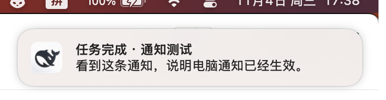

# 任务完成通知（`@local/dsh-task-notify`）

任务跑完、出错或被打断时，以及智能体停下来等你回答 / 审批时，弹一条 **macOS 系统通知**。
不画任何页面元素：通知就是系统横幅本身，和微信、钉钉的通知长一样。
**点一下横幅，DSH 会直接切到出这条通知的那个会话**，不会停在你原来看着的会话上。

## 效果图



*图：macOS 右上角弹出的系统横幅，标题「任务完成 · 通知测试」，正文是该轮回复的摘要（最多 200 字）。*

看不到横幅时，去 **系统设置 → 通知 → DeepSeek Harness** 打开「允许通知」（横幅 + 声音）。

## 什么时候会通知

| 时机 | 通知标题 |
| --- | --- |
| 一轮对话正常跑完 | 任务完成 · 会话标题 |
| 跑失败 | 任务出错 · 会话标题 |
| 被中止 / 打断 / 触到长度上限 | 任务已中止、任务被打断、任务到达长度上限 |
| 智能体调用 `ask_user_question` 等你回答 | 需要你回答 · 会话标题 |
| 有操作等你批准 | 需要你审批 · 会话标题 |

正文是该轮最后一段回复的摘要（最多 200 字）。

**不会通知**：子智能体（subagent）和团队成员的会话 —— 只通知你自己在驱动的主会话。

## 点通知会跳到哪个会话

每条记录都带着它来自的会话 id：

- **页面通知**（浏览器 `Notification`）：点了横幅就把 App 窗口提到前面，并在页面里选中那条会话，
  和你在侧边栏点这一行完全一样。
- **系统兜底**（Host 用 `osascript` 发的那张卡片）：macOS 脚本发出的卡片没有点击回调，点它只会
  把 App 提到前面。所以页面会把这张卡片指向的会话记下来，等窗口**下一次被激活**时切过去 ——
  点卡片本身就是一次激活。卡片超过 10 分钟就不再跟随，避免你之后普通回到窗口时被拽到旧会话。
- 记录里没有会话 id（比如「通知测试」那张）时，点开只把窗口提到前面，不动当前会话。
- 每条会话一张卡片（`tag` 按会话区分），两条会话同时跑完不会互相覆盖、也不会点错。

## 两条投递路径

1. **页面通知**（默认）：Host 通过 `GET /plugins/task-notify/events`（Server-Sent Events）把记录推给网页，
   网页用浏览器的 `Notification` 接口弹出系统通知，归属「DeepSeek Harness」这个 App。
2. **系统兜底**：如果当前没有打开的页面，或所有打开的页面都不能弹浏览器通知，Host 改用 macOS
   `osascript` 发通知。每个页面各自上报权限（`page` 标识），页面关掉后它的权限也一起作废，
   所以一个已经关掉的浏览器标签不会让兜底永远失效。

第 1 条要求系统里允许本 App 通知（一次设置）：
**系统设置 → 通知 → DeepSeek Harness → 允许通知**（横幅 + 声音）。

## 验证

```bash
curl -s -X POST "http://127.0.0.1:<端口>/plugins/task-notify/test?force=1"
# {"ok":true,"clients":1,"permission":"granted","record":{...}}
```

（端口是当前 DSH 的 Web 端口，桌面版每次启动可能不同，看窗口地址或 Host 日志。）

- `clients` 为 0：网页还没加载到插件的浏览器半边（刷新一下页面）。
- `permission` 为 `granted`：浏览器允许通知。
- 记录里 `native` 为 `true`：没有页面能弹浏览器通知，这条是 Host 自己发的兜底卡片。
- 想连跳转一起验：带上真实会话 id，
  `curl -s -X POST "http://127.0.0.1:<端口>/plugins/task-notify/test?force=1&sessionId=<会话 id>"`，
  点这张卡片应当切到那个会话。
- 有记录但没横幅：去「系统设置 → 通知 → DeepSeek Harness」打开允许通知。

页面里也可以直接触发：DevTools 控制台执行 `__dshTaskNotifyTest()`。

## 自检（Host 侧看到了什么）

```bash
curl -s "http://127.0.0.1:<端口>/plugins/task-notify/debug"
```

返回 Host 实际收到的事件计数、`turnEnd` 分类、`emitted` 记录数、`errors`、最近一次投递
（`stats.lastDelivery` 的 `native` 说明走的是哪条路径），以及当前连着的页面 —— 每个页面的
`permission` / `lang` / 打开了几条流（`pages`）。排查「没弹通知」时先看这里：
`sessionEvent` 在涨说明监听正常，`turnEnd.completed` 在涨而 `emitted` 不涨说明被过滤或抛错（`errors` 会有内容）。

## 实现

- `index.js`（Host）：监听 `session/event` 的 `turn/end`、`user-questions/request`、`approval/request`，
  组成记录（含 `sessionId`、标题、摘要）；SSE 广播给页面；没有页面能弹浏览器通知时走 `osascript`。
- `client.js`（Web）：订阅 SSE，用系统通知展示；点通知时调用 `ctx.uiWorkspace.openSession(sessionId)`
  切会话；不能弹浏览器通知时记下会话，在窗口激活时切过去。不渲染任何界面。

## 测试

```bash
node --test "test/*.test.mjs"
```

`test/client.test.mjs` 用假的 `window` / `Notification` / `EventSource` 跑浏览器半边：
验证点卡片会调 `openSession`、一条会话一张卡片、兜底卡片在窗口激活时切会话、以及会话不在
本页目录里时刷新重试。
