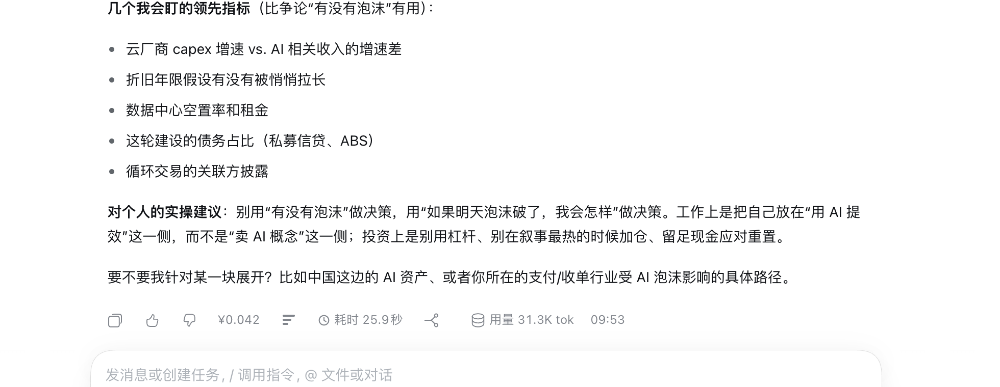

# 单轮耗时（@local/turn-duration）

在每条助手回复的底部操作行显示**这一轮回复用了多久**：从这一轮开始到结束的真实耗时，包含模型思考、工具调用和等待时间。历史会话同样生效，打开旧会话就能看到每一轮的耗时。

## 效果图



*图：助手回复底部的操作行里显示「耗时 25.9秒」（在复制/点赞、本轮花费之后）；鼠标悬停可看到这一轮的开始与结束时间。*

## 显示规则

| 项目 | 说明 |
| --- | --- |
| 位置 | 每条助手回复底部的操作行，紧跟在「本轮花费」之后 |
| 计时口径 | 会话日志中 `turn/start` 到 `turn/end` 的时间差，即整轮实际耗时 |
| 格式 | 不足 1 分钟：`耗时 12.4秒`；1 分钟以上：`耗时 2分34秒`；1 小时以上：`耗时 1时05分` |
| 显示范围 | 只在这一轮的**最后一条**回复下显示；轮内中间步骤、尚未结束的轮不显示 |
| 悬停提示 | `耗时 25.9秒（09:52:44 开始，09:53:10 结束）`，异常结束会附注原因（已中断 / 出错 / 达到长度上限等） |
| 历史会话 | 按会话日志补算，不需要当时开着插件；安装后打开旧会话即可看到 |

## 数据来源与实现

- **Host 侧**（`index.js`）：注册 `turnDuration` 会话投影（`stateVersion: 1`），把日志里的 `turn/start` 与 `turn/end` 折成本轮耗时，并按「结束这一轮的最后一条 assistant 消息 id」索引；`wire.view` 输出纯 JSON 快照，随会话事件增量更新。
- **Client 侧**（`client.js`）：用 `useProjection('turnDuration')` 读投影，在 `conversation.chat.assistant-actions` 槽位注册一个 `turn-duration` 条目（`order: 25`），拿到的 `messageId` 命中才渲染；无数据时返回 `null`，不动宿主原有操作行。
- 计时、格式化和悬停文案都在本地完成，不读取凭据、不发网络请求。
- 界面文案内置中英文字典；主题色取宿主 `--dsw-alias-*` 令牌，跟随明暗主题。

## 安装

本地目录直接装（link 方式，改代码后刷新页面即可）：

```sh
dsh plugin --profile desktop add /path/to/dsh-turn-duration
```

也可以在「插件 → 发现」里通过插件市场索引安装。

## 配置

没有配置项。

## 已知限制

- 只在 DSH Web / 桌面版界面显示（Host 侧投影本身也供其他插件读取）。
- 耗时以 `turn/start` 为起点：用户在输入框里打字、消息排队的时间不计入。
- 精度到 0.1 秒。
- 只有真正产生了助手回复的轮次才有耗时（例如用户发消息后立刻中止、没有回复的轮次不显示）。

## 目录

```
dsh-turn-duration/
├── package.json        # dsh.bundle patch + dsh.client（web）
├── cordis.patch.yml    # 插入 turn-duration 一行 Host 插件
├── index.js            # Host：turnDuration 会话投影（turn/start → turn/end）
├── client.js           # Client：回复底部操作行的耗时条目
├── locale/zh.json      # 插件列表标题/描述（中文）
├── locale/en.json      # 插件列表标题/描述（英文）
├── icon.svg            # 时钟图标
└── docs/preview.png    # 效果图
```
